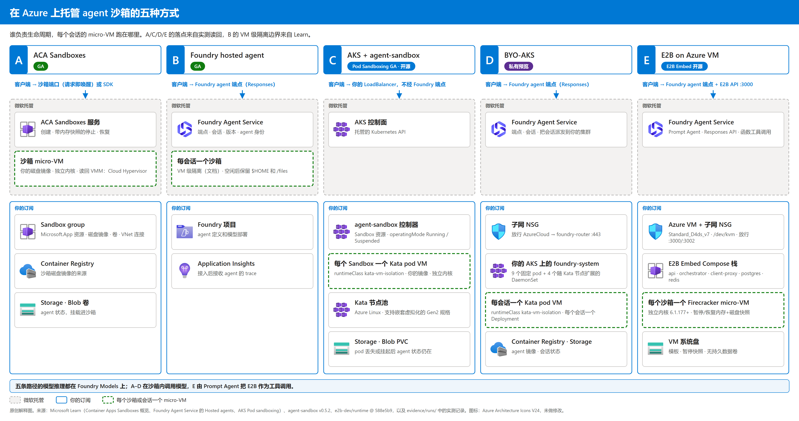

# 在 Azure 上托管 agent 沙箱的五种方式：ACA Sandboxes、Foundry Hosted Agent、AKS + agent-sandbox、BYO-AKS、E2B on Azure VM

[](#目的)
[](#实现效果)
[](https://github.com/xinyuwei-david/Azure-Agent-Sandbox-Hosting/actions/workflows/docs-ci.yml)

作者：魏新宇 · [English](README.md)

## 目的

当你的 AI agent 需要为每个会话分配独立的 micro-VM（带独立内核的轻量虚拟机）沙箱——无论是把整个有状态 agent 容器跑在会话的 micro-VM 内（方案 A–D），还是由 Foundry agent 按需通过工具调用独立的 micro-VM 沙箱（方案 E，或 ACA 动态会话）——接下来都要决定由谁来运行这个 micro-VM 和它的生命周期：交给一个托管服务、交给 Foundry，还是放在你自己的 AKS 节点或 Azure VM 上。五条路径各有取舍，如果把沙箱启动、外挂私有存储卷和模型回答揉成一个数字，光看产品页或粗粒度总耗时很难横向比较。本仓库用同一套可比的有状态交互口径测试五条路径，把每个阶段的耗时单独拆开，给出每条路径的复现步骤，并列出实测结果。A 和 C 共用 workshop 的 reflection agent；B 是另一个采用 Agent Framework 和 ResponsesHostServer 的 agent；D 使用产品组的私有预览 sample；E 使用 Foundry Prompt Agent 调用 Azure VM 上的 E2B Firecracker 沙箱工具，所以这不是相同容器的基准测试：

| 问题 | A · ACA Sandboxes | B · Foundry hosted agent | C · AKS + agent-sandbox | D · BYO-AKS | E · E2B on Azure VM |
|---|---|---|---|---|---|
| 状态 | GA（2026-09-23） | GA（2026-06） | Pod Sandboxing GA（2025-11-18）；agent-sandbox v0.5.2 为开源项目 | **私有预览** | E2B Embed 开源版（`588e5b9`），运行在 Azure Gen2 VM 上 |
| 谁负责会话生命周期 | ACA 服务 | Foundry | 你自己：控制器、网关、空闲回收 | Foundry，运行在你的集群上 | 你自己：你的 VM 上的 E2B 编排器，作为 Foundry agent 工具被调用 |
| 会话的 micro-VM 跑在哪里 | 服务托管的算力 | 微软托管的算力 | 你的 Kata 节点池 | 你的 Kata 节点池 | 你开启嵌套虚拟化（`/dev/kvm`）的 Azure VM |
| 带内存快照的挂起 | 支持 | 不支持：空闲后释放算力，恢复时还原 `$HOME` 和 `/files` | 不保存内存快照：你修改 `operatingMode`；pod 被删除，文件状态从 Blob 恢复 | 未测；预览版是否支持挂起须向产品组确认 | 支持：`beta_pause` 保存 Firecracker 内存和磁盘快照（`vm_state` + `mem_file`） |
| 可选规格 / 节点 SKU（文档） | XS：0.25 vCPU / 0.5 GB<br>S：0.5 vCPU / 1 GB<br>M（默认）：1 vCPU / 2 GB<br>L：2 vCPU / 4 GB<br>XL：4 vCPU / 8 GB | 0.5 vCPU / 1 GiB<br>1 vCPU / 2 GiB<br>2 vCPU / 4 GiB<br>不选择 VM SKU | 支持 Kata 的 Gen2 VM SKU，如 Dsv3 系列；须使用 Azure Linux 并支持嵌套虚拟化 | 在预览开通条件内选择 Kata 节点 SKU；具体可选清单须向产品组确认 | 支持嵌套虚拟化的 Gen2 VM SKU，如 `Standard_D4ds_v7`；E2B `base` 模板默认 2 vCPU / 512 MB |
| 适合的场景 | 要每用户一个 micro-VM、要快照、不想管集群 | 希望 Foundry 托管一切，且它的限制对你没有影响 | 必须自己掌控节点、网络和控制面 | 既要 Foundry 的 agent 平台，**又**要求会话跑在你自己的节点上 | 希望在自有 VM 上获得 100 ms 以内的 Firecracker 创建与内存快照，并由 Foundry agent 作为工具调用 |

产品能力来自 Microsoft Learn，状态来自下文链接的官方公告，实测声明来自我们的运行记录，最后一行是我们的选型建议。一般企业 agent 在 B 的限制可接受时先选 B。对于需要按用户长期运行、要内存快照又不想管集群的场景，先选 A。只有执行节点必须归你时才选 C、D 或 E；如果要求 Foundry 直接把会话 pod 调度到你的 AKS 集群上选 D，如果希望由 Foundry Prompt Agent 按工具调用单台 Azure VM 上自建的 Firecracker 沙箱则选 E。

可选项分四类：[A 的沙箱资源档位](https://learn.microsoft.com/azure/container-apps/sandboxes-overview#resource-tiers)、[B 的沙箱规格](https://learn.microsoft.com/azure/foundry/agents/concepts/hosted-agents#sandbox-sizes)、[C/D 的节点 VM SKU](https://learn.microsoft.com/azure/aks/use-pod-sandboxing)，以及 [E 的宿主 Azure Gen2 VM SKU 加 E2B 模板配额](https://github.com/e2b-dev/runtime/tree/588e5b9500b0987bc5a700d91483b03f0ae7d2a2)。节点或宿主 VM SKU 不是单会话分配规格；在 C/D 中每个 Kata 会话还受 pod 的 requests、limits 和开销限制，在 E 中每个 Firecracker 沙箱受 E2B 模板配额（`base` 模板默认 `2` vCPU / `512` MB）限制。方案 E 同时作为客户在自有 Azure VM 上自建开源 Firecracker 的参照基线，用来与 Azure 原生方案（A–D）横向验证沙箱启动、内存快照恢复与并发密度。节点 SKU 的可用性与配额取决于区域和订阅，D 还须满足预览开通条件。

状态来源：[A 的 GA 公告](https://techcommunity.microsoft.com/blog/appsonazureblog/azure-container-apps-sandboxes-now-generally-available/4559125)、[B 的 GA 公告](https://azure.microsoft.com/updates?id=563596)、[C 的 Pod Sandboxing GA](https://azure.microsoft.com/updates?id=526237)，以及 [E 的开源 E2B Embed 运行时（`588e5b9`）](https://github.com/e2b-dev/runtime/tree/588e5b9500b0987bc5a700d91483b03f0ae7d2a2)；agent-sandbox 和 E2B Embed 本身是开源项目，不是 Azure 托管服务。对 C/D，[Kata 只提供计算隔离](https://learn.microsoft.com/azure/aks/concepts-pod-sandboxing)，不隔离控制面、存储与数据路径，也不限制 cluster-admin 的权限。对 E，宿主机 `/dev/kvm` 上的 Firecracker（`v1.14-0.2.0`）提供每个沙箱的 micro-VM 隔离，但宿主机 OS、Docker 守护进程、E2B API 鉴权和子网 NSG 规则均由你自己负责。



这张图说明的是：各组件归谁所有、micro-VM 的边界在哪里。A、C、D、E 的落点来自我们的读回，B 的 VM 级隔离边界来自 Learn。图里没有画网络细节、身份流转和模型网关。

**各方案执行模型与官方并发配额对比（有状态 Agent 容器直跑 vs 工具沙箱）。** 方案 A–D 把整个有状态 agent 容器跑在会话的 micro-VM 内；而方案 E（以及 Foundry Agent Service 搭配 ACA 动态会话）把 agent 放在 Foundry 托管控制面，仅在执行代码或工具时按需调用独立的 micro-VM 沙箱：

| 执行形态 | Agent 进程在哪里跑 | 工具沙箱（微型 VM）在哪里跑 | 官方并发上限与配额文档说明 | 会话期间是否始终占有一个微型 VM | 空闲暂停与缩零能力 |
|---|---|---|---|---|---|
| **A / B / C / D（有状态 Agent 容器跑在沙箱内）** | 直接跑在微型 VM 沙箱内（与会话 `1:1` 绑定） | 同一个微型 VM（ACA Cloud Hypervisor / Foundry 微型 VM / AKS Kata） | **A**：默认 [500 并发活跃核](https://sandboxes.azure.com/docs/sandboxes/limits)（[标准上限 2,000 核](https://learn.microsoft.com/azure/container-apps/quotas#sandboxes-and-express-quotas)，本订阅实查 `20,000` 核；`3,000` 请求/分钟；已挂起沙箱不占配额）<br>**B**：[按活跃会话 1:1 动态创建](https://learn.microsoft.com/azure/foundry/agents/concepts/hosted-agents#scaling-and-right-sizing)（单会话 `20` GiB 磁盘、`50` MB 上传）<br>**C / D**：受限于你的 AKS Kata 节点池 vCPU/内存配额 | **是** —— 活跃会话期间该微型 VM 保持 Running | **A**：内存快照挂起（`1.58–2.83` s 恢复）<br>**B**：空闲超时或调 `:stop` 释放算力并保留 `$HOME`<br>**C**：改 `operatingMode` 删 pod 并从 Blob 恢复 |
| **E（Foundry Agent Service + E2B on Azure VM 工具沙箱）** | Foundry 托管控制面（无服务器，按模型 token 计费） | 你的 Azure Gen2 VM（`/dev/kvm`）上的 Firecracker 微型 VM | 受宿主 Azure VM 的 vCPU 和内存限制（`1` 台 `Standard_D4ds_v7` VM 实测 `8/8` 并发会话全通、共 `9` 个并发 Firecracker micro-VM；更高并发需升配 VM SKU 或横向扩多台 VM） | **按需** —— 仅在调用 `run_in_e2b_sandbox` 工具时运行；轮次间可 `beta_pause` | 单沙箱支持内存快照暂停（`0.09` s 恢复），但底层宿主 Azure VM（`0.344` USD/h）需常驻运行 |
| **Foundry Agent Service + ACA 动态会话（托管工具沙箱）** | Foundry 托管控制面（无服务器，按模型 token 计费） | 微软托管的 ACA 动态会话 Hyper-V 微型 VM（每个 `identifier`/`session_id` 独占 `1` 个微型 VM） | [**单池最高 600 个并发会话**](https://learn.microsoft.com/azure/container-apps/session-pool#code-interpreter-session-pool)（`--max-sessions` 上限 `600`）× 单区域默认 [**50 个会话池 / 订阅 / 区域**](https://learn.microsoft.com/azure/container-apps/quotas#dynamic-sessions-quotas)（默认单区域最高 **30,000** 并发会话，更高可提单扩容；支持配置 [`readySessionInstances`](https://learn.microsoft.com/azure/container-apps/sessions-custom-container#configuration) 预热池） | **按需** —— 仅在执行期间 + 冷却期 `cooldownPeriod`（`300–3600` s）内占用一个池内微型 VM | 按会话激活时长计费，无需常驻自建 VM；冷却到期或调用 `stopSession`/`deleteSession` 即销毁释放配额（不支持内存快照） |

**ToC 与高并发选型核心权衡：冷启动、预热池（Warm Pool）与全生命周期成本（ACA vs AKS Spot vs E2B）：**
- **冷启动速度与预热池（Warm Pool）：** 面向 ToC 用户的交互式场景最关注两点：冷启动速度与成本。如果不配预热池，基于 Kubernetes 的沙箱（C/D）在新节点上会遭遇拉取镜像或挂卷的冷启动耗时，除非自行维护预热池（如 `agent-sandbox` 的 `SandboxWarmPool`）。ACA Sandboxes（A，不挂私有 Blob 卷时创建中位数仅 <!--v:a.attr.image.median-->2.31<!--/v--> s）和 ACA 动态会话（`readySessionInstances`）由平台底层维护预热池；运行在自有 Azure VM 上的 E2B（E）则通过本地模板快照在 <!--v:e.create.median-->0.07<!--/v--> s（本机 <!--v:e.bench20.create.range-->0.051–0.089<!--/v--> s）内启动 Firecracker micro-VM。
- **成本结构 —— 生命周期管理 + 状态保持 + 恢复速度（ACA 强项） vs Spot 竞价节点（AKS/VM 强项）：** 面对带有大量空闲长尾的潮汐式会话，**ACA（方案 A）在生命周期管理、状态保持与恢复速度上更强**：挂起后自动保存完整内存与磁盘快照（不挂卷 <!--v:a.attr.resume_small.range-->1.58–2.79<!--/v--> s / 带 Blob 卷 <!--v:a.resume.median-->2.83<!--/v--> s 恢复），Stopped 期间不收 CPU/内存费且不占并发活跃核数配额。反过来，**AKS（方案 C）与自建 VM（方案 E）可以使用 [Azure Spot 节点池 / Spot VM](https://learn.microsoft.com/azure/aks/spot-node-pool)**（或预留实例 RI / Savings Plan）大幅压低持续高负载或可容忍中断场景下的单核小时成本——这是按 Serverless 档位计费的 ACA 不具备的；若用 AKS Spot 跑有状态沙箱，业务需自行处理 Spot 驱逐时的状态落盘与重建。

## 实现效果

看结果时要用到的几个词：

| 术语 | 含义 |
|---|---|
| 冷启动（cold） | 新会话或新沙箱从创建到返回第一个回答 |
| 后续回答（warm） | 同一个运行中会话里的下一轮对话 |
| 恢复（resume） | 会话已完成挂起：发起恢复 → 第一个回答；不含停止和空闲等待 |
| pod 丢失（pod lost） | 删除会话所在的 pod 或沙箱，由 Kubernetes 或调用方重新创建 |
| micro-VM | 每个沙箱、会话或 pod 一个带独立 guest 内核的轻量虚拟机（AKS 上是 Kata Containers；ACA 沙箱内读到的 VMM 是 Cloud Hypervisor；E2B 在 KVM 上运行 Firecracker） |

**每条路径的 micro-VM 跑在哪里。** A、C、D、E 来自实测读回，B 来自 Learn 写明的隔离边界：

| | A · ACA Sandboxes | B · Foundry hosted agent | C · AKS + agent-sandbox | D · BYO-AKS | E · E2B on Azure VM |
|---|---|---|---|---|---|
| 隔离边界 | 每个沙箱一个 micro-VM | 每会话一个 VM 级隔离的沙箱（Learn） | 每个 Sandbox 一个 Kata pod VM | 每个会话一个 Kata pod VM | 每个沙箱一个 Firecracker micro-VM |
| VMM 和 hypervisor | API 返回 `vmm_type` <!--v:a.vmm.value-->cloudhypervisor<!--/v-->；文档没有写 hypervisor | 未公开；文档只说明 VM 级隔离 | Microsoft Hyper-V 上的 Cloud Hypervisor（Learn） | 与 C 相同 | Linux KVM（`/dev/kvm`）上的 `vmm_type` <!--v:e.vmm.value-->firecracker<!--/v-->（<!--v:e.isolation.firecracker_version-->v1.14-0.2.0<!--/v-->） |
| 读到的内核 | guest <!--v:a.isolation.guest_kernel-->6.12.8+<!--/v--> | 未暴露，无法读回 | pod <!--v:c.isolation.guest_kernel-->6.6.137.mshv1-1.azl3<!--/v-->，runc pod <!--v:c.isolation.system_node_kernel-->6.8.0-1067-azure<!--/v--> | Kata 节点池节点 <!--v:d.node_kernel.value-->6.6.137.mshv2-2.azl3<!--/v-->；未在会话 pod 内读取 | guest <!--v:e.isolation.guest_kernel-->6.1.177+<!--/v-->，宿主机 VM <!--v:e.isolation.host_kernel-->6.17.0-1022-azure<!--/v--> |
| 节点归谁 | 微软 | 微软 | 你 | 你 | 你 |

B 的“每会话一个、VM 级隔离”是 `SOURCE_FACT`，不是本地读回的 VMM 或内核结果。C 和 D 用的是同一个 Kata runtime class，所以隔离方式并不能区分它们，真正的区别在于由谁来运行平台。E 在你自己的 Azure Gen2 VM 内直接经 `/dev/kvm` 运行 Firecracker。

**按阶段拆细的秒数。** 如果把纯沙箱启动、外挂私有 Azure Blob 卷和第一轮 agent 回答揉成一个冷启动数字，A 会因为完整 workshop 配置同步挂载私有 Blob 卷（+<!--v:a.blob_mount_overhead.value-->21.94<!--/v--> s）而显得很慢，但实际上 A 原生支持 `Memory` 内存快照，跨挂起保留会话状态并不需要外挂 Blob 卷。下面把每个阶段单独拆开。A 是 2026-10-09 三次实测的中位数及归因矩阵；B 和 C 是 2026-09-27 各一次实测；D 是 2026-09-29 的一轮压测；E 是 2026-10-14 的一轮压测。A 和 C 使用 workshop reflection agent；B 使用 Agent Framework 和 ResponsesHostServer；D 使用私有预览 sample；E 使用 Foundry Prompt Agent 调用 E2B 沙箱工具。它们使用同一个模型和有状态交互，但不是相同容器。B 和 D 是从中国的一台笔记本经 Foundry 端点调用的（到 Azure 的往返时延 <!--v:d.client_rtt.range-->320–800<!--/v--> ms）；E 是从 East US 2 的工作站调用的；A 的回答在沙箱内计时，C 在它的 LoadBalancer 处计时。请把同一行作为现场记录来读，不要当作受控的产品基准测试：

**各路径启动计时定义、测试问题原文与可执行压测脚本。** 纯沙箱或 pod 启动耗时从发出 CLI/SDK 创建请求开始计时，到沙箱或 pod 状态变为就绪（`Running` / `Active` / `Ready`）为止，不含模型推理：

| 测试口径与覆盖路径 | 纯沙箱 / pod 就绪计时起点 → 终点 | 按顺序发送的测试问题原文 | 仓库内可执行压测脚本 |
|---|---|---|---|
| **有状态 Agent 与挂起/恢复（`A`、`C`、`E`）** | **A**：SDK `_do_create_sandbox` → `get_sandbox` 状态 `Running`<br>**C**：`kubectl apply` / `operatingMode: Running` → Sandbox `Ready`<br>**E**：`Sandbox.create("base")` → Firecracker `Running` | 第 `1` 轮：`"Where is Bangkok? Answer in one short sentence."`<br>第 `2` 轮（后续）：`"How many questions have I asked before this one? Number only."`<br>第 `3–4` 轮（挂起恢复后）：`"How many questions have I asked before this one? Number only."` | [`tools/measure_aca.py`](tools/measure_aca.py)<br>[`tools/measure_e2b.py`](tools/measure_e2b.py)（`agent` 模式） |
| **Responses 冷启动、追问、并发与恢复（`B`、`D`、`E`）** | **B**：`POST .../endpoint/sessions` → `Active`（或 `/responses` 首字节）<br>**D**：Pod `creationTimestamp` → `Ready` 条件<br>**E**：`Sandbox.create("base")` → Firecracker `Running` | 冷启动（`n` 个新会话）：`"Reply with exactly COLD-{i}"`<br>同会话追问（`1` 个会话）：`"Remember the code word LANTERN-7. Reply only OK."` → `"What is the code word? Reply with the word only."` → `"Reply with exactly WARM-{i}"`<br>并发（`4` 和 `8` 并发）：`"Remember SCALE-{i}. Reply only OK."` → `"What did I ask you to remember? Word only."` | [`tools/measure_responses.py`](tools/measure_responses.py)<br>[`tools/measure_e2b.py`](tools/measure_e2b.py)（`perf` 模式） |

A 和 E（A 口径）的冷启动和恢复到回答采用分段相加，不是客户端连续端到端计时：SDK 创建或恢复的耗时，加上沙箱内计时的回答耗时（A）或 Prompt Agent 轮次耗时（E）。C 的冷启动同样是 apply 到 Ready 加第一个回答。恢复从挂起完成后开始计时，不含停止和空闲等待。B 的后续回答行使用 gateway（APIM）模型路由；direct 路由的结果在 VALIDATION 单独列出。

**这些秒数不能用来给五种产品做性能排名。** 各路径的计时位置、问题输入、reasoning 设置、输出 token 数、镜像缓存和样本量，并未统一控制或逐次完整记录。模型名相同不代表时延测试条件相同。数值合理性校验能拦住无效耗时，但不能证明产品性能，也不能补齐缺失的打点。

<!-- BEGIN GENERATED: comparison -->
| 实测或文档项 | A · ACA Sandboxes | B · Foundry hosted agent | C · AKS + agent-sandbox | D · BYO-AKS | E · E2B on Azure VM |
|---|---|---|---|---|---|
| **纯沙箱或 pod 就绪（不挂外部卷）** | 中位数 2.31 s（1.6–2.7；n=3）；加 VNet 1.97–2.52 s（n=2），加端口 2.3–2.33 s（n=2） | 首次 `/responses` 自动创建（首字节 7.66 s gateway、3.61 s direct，n=1）；亦支持 `POST .../endpoint/sessions` 显式预建 | 镜像已缓存（含 PVC）：恢复 → Ready 17.1 s（n=1），删 pod 重建 → Ready 23.4 s（n=1）；新节点 + PVC 44.9 s（n=1） | 镜像已缓存 8–10 s（n=6）；新节点 25 s（n=2） | 跨网 中位数 0.07 s（0.06–0.14；n=3）；本机 0.051–0.089 s（n=20） |
| **外挂私有存储卷附加耗时** | 挂载私有 Blob 卷增加中位数 +21.94 s（create → Running 中位数 24.25 s（24.12–44.86；n=3））；Memory 快照无需挂卷 | 无（平台恢复 $HOME 和 /files） | 带 Blob PVC 的 apply → Ready 44.9 s（n=1；跨挂起保状态必需） | 会话 pod 未挂外部卷 | 无（Firecracker 快照写本机 SSD） |
| **沙箱就绪后 → 第一个回答** | 中位数 3.88 s（2.82–5.55；n=3），沙箱内计时 | 已就绪沙箱内 4.03, 5.54 s（n=2）（gateway）与 4.94, 4.38 s（n=2）（direct） | 12.75 s（n=1），在 LoadBalancer 处计时 | pod Ready 后 中位数 15.49 s（14.01–16.16；n=3）（agent 轮次 2–5 s） | 中位数 4.12 s（2.82–8.38；n=3）（A 口径）；中位数 3.44 s（2.28–7.75；n=5）（D 口径） |
| **新会话 → 第一个回答（不挂外部卷，同口径）** | 合成中位数 6.19 s（镜像创建 2.31 s + 首次回答 3.88 s） | 9.43 s（n=1，经 Foundry 端点；模型路由：gateway（APIM））；5.29 s（n=1，direct） | 不适用（不挂 Blob PVC 无法跨挂起保状态） | 中位数 25.49 s（23.53–26.7；n=5），经 Foundry 端点 | 中位数 4.26 s（2.89–8.44；n=3）（A 口径）；中位数 3.6 s（2.54–7.94；n=5）（D 口径） |
| **新会话 → 第一个回答（带私有 Blob 卷）** | 中位数 28.0 s（27.07–50.41；n=3）；SDK 创建 + 沙箱内回答 | 未挂外部 Blob 卷 | 57.65 s（n=1；apply → Ready 44.9 s + 回答 12.75 s） | 未挂外部 Blob 卷 | 未挂外部 Blob 卷 |
| **同一会话的后续回答** | 中位数 1.05 s（1.04–1.54；n=3） | 4.03, 5.54 s（n=2）；模型路由：gateway（APIM） | 1.96 s（n=1） | 中位数 12.9 s（11.17–16.42；n=3） | 中位数 2.95 s（2.83–3.92；n=3）（A 口径）；中位数 3.39 s（3.19–5.03；n=3）（D 口径）；本机沙箱内命令 0.007–0.01 s（n=20） |
| **挂起 / 暂停与恢复就绪耗时** | 停止 中位数 7.56 s（5.97–9.31；n=3）；恢复 → Running 不挂卷 1.58–2.79 s（n=7），带 Blob 卷 中位数 2.83 s（1.61–3.02；n=3） | 空闲超时（120–3600 s，默认 900 s）或显式调用 `POST .../sessions/{id}:stop` 释放算力并保留 `$HOME`（无内存快照） | 挂起 → pod 消失 9.7 s（n=1）；恢复 → Ready 17.1 s，LoadBalancer 健康 26.1 s（n=1） | 未测；预览版是否支持挂起须向产品组确认 | 暂停 中位数 0.13 s（0.11–0.15；n=3）（本机 0.051–1.81 s（n=20））；恢复 → Running 中位数 0.09 s（0.08–0.11；n=3）（本机 0.086–0.62 s（n=20）） |
| **发起恢复 → 第一个回答（不含停止）** | 中位数 14.45 s（12.44–17.22；n=3）；恢复本身另行统计的中位数 2.83 s | 带同一 `agent_session_id` 的下次请求自动重配算力并恢复 `$HOME` 与 `/files`（[会话文档](https://learn.microsoft.com/azure/foundry/agents/how-to/manage-hosted-sessions#stop-a-session)） | 34.2 s（n=1；Ready 17.1 s，LoadBalancer 健康 26.1 s） | 未测；预览版是否支持挂起须向产品组确认 | 中位数 6.48 s（4.73–12.82；n=3）；恢复本身另行统计的中位数 0.09 s |
| **pod 或沙箱丢失 → 重新就绪** | 未测（服务托管） | 未测（平台托管） | 23.4 s（n=1）；同一 Sandbox 的状态已恢复 | 23.9 s（n=1）；未测试被删会话的连续性 | 0.1 s（n=1）；另一个存活会话在 2.61 s 内回答 |
| **空闲策略（官方说明）** | [官网](https://learn.microsoft.com/azure/container-apps/sandboxes-overview#lifecycle-states)：可配置空闲自动挂起；可选 Memory 或 Disk 快照模式 | [官网](https://learn.microsoft.com/azure/foundry/agents/concepts/hosted-agents#sessions)：空闲超时 2–60 min（默认 15）后释放算力，保留 $HOME 和 /files；30 天不活跃后删除会话 | [官方 API](https://github.com/kubernetes-sigs/agent-sandbox/blob/v0.5.2/docs/api.md)：shutdownTime 是定时到期回收，不是按请求检测空闲；空闲回收需自行实现 | 未找到可核实的官方公开空闲策略；须向产品组确认 | [E2B 文档](https://e2b.dev/docs/sandbox)：按沙箱设置超时（默认 5 min），支持显式 `beta_pause` / `connect` |
| **容量** | 无服务器；默认 500 并发活跃核（标准上限 2000，本订阅实查 20000）及 3000 请求/分钟（[文档](https://sandboxes.azure.com/docs/sandboxes/limits)）；动态会话：600 会话/池 × 50 池/区域 | 平台按会话 1:1 动态创建（[文档](https://learn.microsoft.com/azure/foundry/agents/concepts/hosted-agents#scaling-and-right-sizing)）；单会话最高 20 GiB 磁盘（系统预留 20%）及 50 MB 文件上传 | 你的 Kata 节点池 | 单个 Standard_D4s_v5 节点观察到最多 5 个会话；3 个节点共 12 个；`500 session_creation_failed`、`429 aks_quota_exceeded` | 4 并发 4/4、8 并发 8/8 在 1 台 Standard_D4ds_v7 VM 上全部成功（共 9 个并发 Firecracker micro-VM） |
| **本次路径部署耗时** | 146.6 s（sandbox group、VNet 连接、磁盘镜像、卷、沙箱） | 161 s（`azd deploy`；模型路由：gateway（APIM）） | 812.9 s（准备脚本、私有链接、apply） | 854 s（角色、`azd provision`、`azd deploy`；作者控制台记录，原始输出未保留） | 177 s（Docker Engine 33.0 s + E2B Compose 与 base 模板 144 s） |

**本地配置与观察，不是官网空闲策略：** A 本次使用 Memory 模式，自动挂起设置为 900 s。D 最早的 pod 在创建至少 87 min 后仍为 Running；这是 pod 的年龄，不是空闲时长或回收超时。
<!-- END GENERATED: comparison -->

值得注意的几点：
- **把纯沙箱创建与外挂私有 Blob 卷拆开后，A 的真实速度非常清楚：** 不挂私有 Blob 卷时，A 创建自定义镜像沙箱的中位数仅 <!--v:a.attr.image.median-->2.31<!--/v--> s（只加镜像、VNet 或端口为 <!--v:a.attr.small.range-->1.6–2.7<!--/v--> s），对应的无卷冷启动首答合成中位数约 <!--v:a.cold_no_volume.value-->6.19<!--/v--> s（`<!--v:a.attr.image.median-->2.31<!--/v-->` s + `<!--v:a.first_answer.median-->3.88<!--/v-->` s），且同会话后续回答中位数 <!--v:a.warm.median-->1.05<!--/v--> s 是五条路径中最快的。挂载私有 Blob 卷额外增加了 +<!--v:a.blob_mount_overhead.value-->21.94<!--/v--> s 中位数（归因测试中升至 <!--v:a.attr.vnetvolume.range-->15.79–25.12<!--/v--> s，完整 agent 测试中为 <!--v:a.create.median-->24.25<!--/v--> s）。由于 A 原生支持 `Memory` 内存快照（不像 C 挂起会删除 pod），A 仅为了跨挂起保留会话状态时并不需要外挂 Blob 卷。
- **E（E2B on Azure VM）在单台 VM 上实现了 100 ms 以内的 Firecracker 创建与快照唤醒：** 沙箱创建跨网中位数为 <!--v:e.create.median-->0.07<!--/v--> s（本机 20 次 <!--v:e.bench20.create.range-->0.051–0.089<!--/v--> s），恢复中位数为 <!--v:e.resume.median-->0.09<!--/v--> s（本机 <!--v:e.bench20.resume.range-->0.086–0.62<!--/v--> s），单台 `Standard_D4ds_v7` VM 上 4/4 和 8/8 并发全部成功。你需要自己维护 VM 操作系统、Docker Compose 栈、网络安全规则与扩缩容。
- **D（BYO-AKS）当前处于私有预览阶段，重在验证产品形态，性能收敛计划在公开预览阶段完成：** 在当前预览 build 中，会话 pod 在 <!--v:d.pod_ready.range-->8–10<!--/v--> s 内就绪，而端到端范围是 <!--v:d.cold.range-->23.53–26.7<!--/v--> s（pod Ready 后到首答中位数 <!--v:d.first_after_ready.median-->15.49<!--/v--> s）；同一台笔记本直接调用同一个模型的中位数是 <!--v:d.model_direct.median-->2.69<!--/v--> s（low reasoning effort；该直连基线不是与 agent 配置完全匹配的基准测试）。没有打点的剩余时间只能统称为端点、会话和 agent 链路，不能当成已测出的网关内部耗时。按产品组说明，现阶段 Private Preview 主要用于展示和验证「Foundry 控制面 + 客户自有 AKS Kata 节点池」的产品形态，性能问题计划在 Public Preview 阶段解决，目前的目标是至少达到与全托管 Foundry（方案 B）同一水平线上。
- 在本次观察到的 D 预览 build 里，应保守地按“开过的会话数”而不只是“正在执行的请求数”规划容量；pod 年龄的观察不能证明空闲回收超时。

**每次实测。** 按 A→B→C→D→E 分组，同一路径内按日期从早到晚排列，与 [VALIDATION_CN.md](VALIDATION_CN.md) 的顺序一致；该页记录每次实测的输入、过程、结果和边界：

<!-- BEGIN GENERATED: runs -->
| 实测 | 路径 | 场景 | 结果 |
|---|---|---|---|
| `a-2026-09-27-setup` | A | 首次部署，请求唤醒 | 部署 146.6 s；向已停止的沙箱发请求，23.7 s 后回答；内核 `6.12.8+` |
| `a-2026-10-09-agent` | A | 完整 agent，跑 3 次 | 冷启动 28.0 s、后续 1.05 s、恢复到回答 14.45 s（中位数）；3/3 次 vmm 为 `cloudhypervisor`；历史持续增长 3/3 |
| `a-2026-10-09-attribution` | A | 按配置拆分创建耗时 | 只加镜像、VNet 或端口 1.6–2.7 s；加私有 Blob 卷后 15.79–25.12 s |
| `a-2026-10-09-late-mount` | A | 先启动、后挂 Blob | 启动 3.99–7.2 s，再挂载 12.4–20.29 s（n=2） |
| `b-2026-09-27` | B | 部署、新会话、后续回答；gateway 模型路由 | 部署 161 s；新会话 9.43 s；后续 4.03, 5.54 s |
| `c-2026-09-27` | C | Kata Sandbox、pod 丢失、挂起/恢复 | pod 内核 `6.6.137.mshv1-1.azl3`，Ubuntu 系统节点池的 runc pod 内核 `6.8.0-1067-azure`；pod 丢失后 23.4 s 就绪；恢复到回答 34.2 s |
| `d-2026-09-29-placement` | D | 会话跑在哪里 | 加 NSG 规则 `Allow-AzureCloud-FoundryRouter-443` 后，每个会话 pod 都是 `kata-vm-isolation`，跑在你的节点池上 |
| `d-2026-09-29-perf` | D | 冷启动、后续、4 和 8 并发 | 冷启动 25.49 s、后续 12.9 s（中位数）；4 并发 0/4、8 并发 2/8 回答（节点池已满） |
| `d-2026-09-29-recovery` | D | 删除一个会话 pod | 23.9 s 后替代 pod 就绪；另一个存活会话在 14.8 s 内回答；未测试被删会话的连续性 |
| `e-2026-10-14-agent` | E | Prompt Agent + E2B，跑 3 次 + 20 次微基准 | 创建 0.07 s（本机 0.051–0.089 s）、冷启动 4.26 s、后续 2.95 s、恢复到回答 6.48 s（中位数）；3/3 次 vmm 为 `firecracker`；历史持续增长 3/3 |
| `e-2026-10-14-perf` | E | 冷启动、后续、4 和 8 并发、沙箱替换 | 冷启动 3.6 s、后续 3.39 s（中位数）；4 并发 4/4、8 并发 8/8 回答；0.1 s 后替代沙箱就绪 |
<!-- END GENERATED: runs -->

**边界。**
- 只测了一个区域（East US 2）。A 的完整 agent 时延 n=3；B 和 C 各是一轮端到端实测；D 是一轮压测，其中镜像已缓存的冷启动 n=5、后续回答 n=3，会话落地和恢复各一次；E 是在单台 `Standard_D4ds_v7` VM 上的一轮压测：A 口径 n=3，D 口径冷启动 n=5、后续回答 n=3，并发 4 和 8，以及本机微基准 n=20。在依赖某个数字之前，请按 VALIDATION_CN 中的在线测量命令重新测。
- 这些是实施过程中的观察，不是产品基准测试，也不是 SLA。文档说 A 可以从预热池实现亚秒级启动；我们带私有 Blob 卷的完整配置没有达到，而不带卷的仅镜像创建中位数为 <!--v:a.attr.image.median-->2.31<!--/v--> s。
- D 是处于功能形态验证阶段的私有预览，它的行为（会话落地、空闲回收、各项限制以及公开预览优化前的时延）可能变化，接入需要产品组的示例和开通。
- 没有测的：B 在空闲释放前的恢复秒数，A 和 B 的 pod 或宿主机丢失，由 Foundry 治理的 agent 按任务调用 ACA 沙箱（微软在 GA 后介绍的模式），以及多节点 E2B 集群。
- 成本：D 的两节点保底费用为两个 `Standard_D4s_v5` 节点加 AKS Standard 层 <!--v:d.cost_floor.value-->0.484<!--/v--> USD/h；E 的单 VM 保底费用为一台 `Standard_D4ds_v7` VM、一个 Standard 静态公网 IP 加一块 50 GB Premium SSD P6 磁盘，按 East US 2 零售价为 <!--v:e.cost_floor.value-->0.344<!--/v--> USD/h。请按你自己的价格核算。

## 操作步骤

**先部署，再使用 agent。** 主线按[同事的固定版本 workshop](https://github.com/oxcp/ainotes/tree/905f2c2/agenthost)组织：创建共享底座 → 部署所选方案 → 打开或调用应用。压测和历史结果重算是可选项，不属于部署步骤。

**执行边界：** 原始部署产生了仓库保留的历史结果，但下面这套参数化步骤尚未在全新订阅逐条重跑。D 还依赖产品组的私有示例和开通；离线 CI 不能证明云端部署成功。

| 顺序 | 在哪里 | 做什么 | 入口 |
|---|---|---|---|
| 1 | 工作站 | 克隆、填写配置、登录 | `config/.env.example` |
| 2 | Azure 订阅 | 创建共享底座 | workshop `module-01/setup.sh` |
| 3 | C | 构建镜像、创建 AKS、部署 Sandbox 并打开应用 | workshop `module-03` |
| 4 | A | 创建 sandbox group 并部署 agent 沙箱 | workshop `module-04` + `tools/aca_sandbox.py` |
| 5 | B | 部署 hosted agent 并调用 | workshop `module-02` |
| 6 | D | 绑定现有 AKS，部署并调用私有预览 agent | 产品组示例 |
| 7 | E | 在 Azure Gen2 VM 上部署 E2B Embed 并由 Foundry Prompt Agent 调用 | `e2b-dev/runtime` |

**A = ACA Sandboxes，B = Foundry hosted agent，C = AKS + agent-sandbox，D = BYO-AKS，E = E2B on Azure VM**。上游把 module-02 叫 Solution A、module-03 叫 Solution B、module-04 叫 Solution C；看它时以模块编号为准。只执行所选方案：B 的前置是第 1–2 步；这里 A 的完整示例复用第 3 步创建的镜像和网络，但 ACA 产品本身不依赖 AKS。D 使用已有集群和单独开通的示例，本页不会自动替你新建 D 的集群。E 在单台开启嵌套虚拟化的 Azure VM 上运行开源 E2B Embed Docker Compose 栈。

**前提。** Bash、Git、curl、带 venv 模块的 Python 3.10+（Ubuntu/Debian 需安装 `python3-venv`）、Azure CLI 2.80+、kubectl、azd 1.34+；执行 `azd ext install microsoft.foundry` 安装扩展。订阅权限需 Owner，或 Contributor 加 Role Based Access Control Administrator，所选区域需有模型配额。部署 A 时，你的身份还需要 `Container Apps SandboxGroup Data Owner` 角色（[Learn](https://learn.microsoft.com/azure/container-apps/sandboxes-overview#prerequisites)）；workshop 的 `sandbox-deploy.sh` 能识别当前登录用户时会自动分配，识别不了只打印警告。使用非生产订阅。C 需要填写实际公网出口 CIDR；这个 HTTP workshop 应用不是生产级 HTTPS/登录部署。

**1. 克隆并填写配置。** 克隆到新目录后编辑 `.env`：填写 `SUBSCRIPTION_ID`、`LOCATION`、`RESOURCE_GROUP`；部署 C 时填写 `C_ALLOW_CIDR`。`SN` 在第 2 步拿到后再填。

```bash
git clone --filter=blob:none https://github.com/xinyuwei-david/Azure-Agent-Sandbox-Hosting.git
cd Azure-Agent-Sandbox-Hosting
export HOSTING_REPO="$PWD"
git clone https://github.com/oxcp/ainotes.git "$HOME/ainotes"
git -C "$HOME/ainotes" checkout 905f2c2
cp config/.env.example .env
python3 -m venv .venv
. .venv/bin/activate
python -m pip install -r requirements.txt
```

编辑完成后登录，运行上游前置检查。工具、权限或配额未满足时先解决，不要继续创建资源。后续都在这个 shell 中操作：它保存着用来回到本仓库的 `HOSTING_REPO`，以及已激活的 `.venv`。

```bash
az login
set -a && . "$HOSTING_REPO/.env" && set +a
az account set --subscription "$SUBSCRIPTION_ID"
(cd "$WORKSHOP_DIR/agenthost" && chmod +x check-prerequisites.sh && ./check-prerequisites.sh)
```

**2. 创建共享底座。** [Module 1](https://github.com/oxcp/ainotes/blob/905f2c2/agenthost/module-01/README.md)创建 Foundry 项目和模型、APIM、ACR、Storage 与托管身份。

```bash
(cd "$WORKSHOP_DIR/agenthost/module-01" && chmod +x setup.sh && ./setup.sh)
az group show -g "$RESOURCE_GROUP" --query tags.deploymentSN -o tsv
```

成功标志：脚本输出 `Template deployed successfully.`，第二条命令返回非空后缀。把后缀填到 `.env` 的 `SN`，重新加载，让所有派生资源名一起更新；不能保留 `YOUR-DEPLOYMENT-SUFFIX` 继续执行。

```bash
set -a && . "$HOSTING_REPO/.env" && set +a
```

**3. C — 部署 AKS 上的应用。** 按 [Module 3](https://github.com/oxcp/ainotes/blob/905f2c2/agenthost/module-03/README.md)执行。准备脚本创建 AKS/Kata、控制器、镜像和 PVC，并不部署应用；后面的 `kubectl apply` 才创建 Sandbox 和 Service。

```bash
cd "$WORKSHOP_DIR/agenthost/module-03"
chmod +x prepare-agent-sandbox.sh deploy-storage-private-link.sh
./prepare-agent-sandbox.sh
if [ "$(az storage account show -g "$RESOURCE_GROUP" -n "$ACA_STORAGE_ACCOUNT" --query publicNetworkAccess -o tsv)" = "Disabled" ]; then
  ./deploy-storage-private-link.sh
fi
kubectl apply -f agent-sandbox.yaml
kubectl wait sandbox agent-host -n "$NAMESPACE" --for=condition=Ready --timeout=5m
```

成功标志：Sandbox 到达 `Ready`。接下来只允许配置的出口 CIDR，取出真正的应用地址并发起请求：

```bash
if [ -z "$C_ALLOW_CIDR" ] || [[ "$C_ALLOW_CIDR" == YOUR-* ]]; then
else
  kubectl patch service agent-host-lb -n "$NAMESPACE" --type merge \
    -p "{\"spec\":{\"loadBalancerSourceRanges\":[\"$C_ALLOW_CIDR\"]}}"
  kubectl wait service agent-host-lb -n "$NAMESPACE" --for=jsonpath='{.status.loadBalancer.ingress[0].ip}' --timeout=5m
  C_AGENT_HOST=$(kubectl get service agent-host-lb -n "$NAMESPACE" -o jsonpath='{.status.loadBalancer.ingress[0].ip}')
  C_AGENT_URL="http://${C_AGENT_HOST}"
  printf 'C application: %s\n' "$C_AGENT_URL"
  curl --fail-with-body --show-error --max-time 30 "$C_AGENT_URL/ready"
  curl --fail-with-body --show-error --max-time 180 \
    -H 'Content-Type: application/json' \
    -d '{"query":"Where is Bangkok? Answer in one short sentence."}' "$C_AGENT_URL/reflect" | \
    python -c 'import json,sys; body=json.load(sys.stdin); answer=body.get("response"); print(json.dumps(body,ensure_ascii=False)); sys.exit(0 if isinstance(answer,str) and answer.strip() else "C invocation failed: non-empty response missing")'
fi
cd "$HOSTING_REPO"
```

如果第一行打印了 `C_ALLOW_CIDR` 的提示，说明后面的命令都没有执行：填好它，重新加载 `.env`，再运行一次这段命令。
浏览器打开打印出的地址即可使用聊天页面。`/ready` 应成功，`/reflect` 应返回非空 `response`；pod Ready 不等于应用已能回答。失败时在 `NAMESPACE` 查看 `kubectl get pods`、`kubectl describe pod`、`kubectl logs`；HTTP 不通还要检查出口 CIDR、Service 地址和网络规则。

**4. A — 部署 ACA 沙箱里的 agent。** [Module 4](https://github.com/oxcp/ainotes/blob/905f2c2/agenthost/module-04/README.md)创建 sandbox group；磁盘镜像和沙箱需要继续创建。下方 SDK 命令实际执行这些操作，不是重放测量记录。这里的完整示例复用第 3 步的镜像和网络；`ACA_SUBNET_PREFIX` 必须是该 VNet 内尚未占用的地址段。按 workshop 的做法，`aca-subnet` 建在 AKS 节点资源组的 VNet 里；[AKS 文档](https://learn.microsoft.com/azure/aks/faq)说明修改该资源组内的资源不受支持，删除集群时这个资源组也会一起删除。这只是 workshop 的简便做法；正式环境请在你自己管理的 VNet 里为 sandbox group 准备委派子网。

```bash
(cd "$WORKSHOP_DIR/agenthost/module-04" && chmod +x sandbox-deploy.sh && ./sandbox-deploy.sh)
NODE_RG=$(az aks show -g "$RESOURCE_GROUP" -n "$AKS_NAME" --query nodeResourceGroup -o tsv)
VNET=$(az network vnet list -g "$NODE_RG" --query "[0].name" -o tsv)
az network vnet subnet create -g "$NODE_RG" --vnet-name "$VNET" -n aca-subnet \
  --address-prefixes "$ACA_SUBNET_PREFIX" --delegations Microsoft.App/environments --query id -o tsv
```

把打印出的子网 ID 填到 `.env` 的 `ACA_SUBNET_ID`，再回本仓库执行：

```bash
cd "$HOSTING_REPO"
set -a && . ./.env && set +a
python tools/aca_sandbox.py vnet
python tools/aca_sandbox.py image
python tools/aca_sandbox.py volume
python tools/aca_sandbox.py create
python tools/aca_sandbox.py ask "Where is Bangkok? Answer in one short sentence."
```

成功标志：`create` 返回 Running，`ask` 返回真实回答。这里通过沙箱 exec 调用应用，不代表浏览器入口已开放；需要浏览器入口时按 Module 4 配置端口和 IP。缺配置先补齐再重试；镜像访问失败检查 ACR 权限，私有 Blob 访问依赖 VNet 和私有终结点。

**5. B — 部署并调用 hosted agent。** 在源代码克隆目录之外的新工作目录执行 [Module 2](https://github.com/oxcp/ainotes/blob/905f2c2/agenthost/module-02/README.md)。绑定已有项目后直接部署，B 不执行 `azd provision`。

```bash
mkdir -p "$HOME/workshop-b" && cd "$HOME/workshop-b"
azd auth login
azd ai agent init -m "$WORKSHOP_DIR/agenthost/module-02/azure.yaml" --project-id "$PROJECT_ID"
cd maf-agent
sed -i "s/<SN>/$SN/g" azure.yaml
azd env set AZURE_SUBSCRIPTION_ID "$SUBSCRIPTION_ID"
azd env set AZURE_LOCATION "$LOCATION"
azd env set AZURE_RESOURCE_GROUP "$RESOURCE_GROUP"
azd env set AZURE_AI_PROJECT_ID "$PROJECT_ID"
azd env set FOUNDRY_PROJECT_ENDPOINT "$PROJECT_ENDPOINT"
azd env set AI_MODEL_DEPLOYMENT_NAME gpt-5.4-mini
azd env set AZURE_TENANT_ID "$(az account show --query tenantId -o tsv)"
azd deploy
azd ai agent invoke "Hi"
azd ai agent show
cd "$HOSTING_REPO"
```

成功标志：部署结束且 `invoke` 返回真实回答。`show` 提供已部署的端点，可供 API 客户端调用，也可进入 Foundry agent playground 使用。默认保持 gateway 路由；只有明确需要时才改变。若部署一直 creating，查看 `azd ai agent monitor` 和门户状态，不能把超时当成功，也不要自动删除 agent。

**6. D — 私有预览部署。** 没有产品组示例和订阅开通就不能执行这条路径。先填写 `.env` 的 BYOAKS 配置，包括 `BYOAKS_SAMPLE_DIR`，并按示例当前指南配置 `AKS_RESOURCE_ID`、`HOSTING_IDENTITY_RESOURCE_ID`、`WORKLOAD_IDENTITY_RESOURCE_ID`、`STORAGE_ACCOUNT_RESOURCE_ID`、`ACR_RESOURCE_ID`、`APPLICATIONINSIGHTS_RESOURCE_ID`。只有功能标志 Registered 不代表已开通。

**D1. 准备现有集群的 Kata 节点池。** 先确认该节点 SKU 在订阅和区域可用，并符合当前开通要求；已有同名节点池时不要重复创建。

```bash
az aks nodepool add -g "$BYOAKS_RESOURCE_GROUP" --cluster-name "$BYOAKS_CLUSTER" -n "$BYOAKS_KATA_POOL" \
  --os-sku AzureLinux --workload-runtime KataVmIsolation --node-vm-size "$BYOAKS_KATA_VM_SIZE" --node-count 1
```

**D2. 在已配置的示例目录执行绑定。** 成功条件是 provision 完成、foundry-system 组件就绪，不是 pod 数量等于某个历史值。

```bash
cd "$BYOAKS_SAMPLE_DIR"
azd config set auth.useAzCliAuth true
azd auth login
azd provision
az aks get-credentials -g "$BYOAKS_RESOURCE_GROUP" -n "$BYOAKS_CLUSTER" --overwrite-existing
kubectl get pods -n foundry-system
```

**D3. 仅在需要时配置 router 网络路径。** 下方子网 NSG 规则是保留的 workshop 接法，不是通用生产规则。只有产品组确认该入口和来源适用于当前预览版本、且子网 NSG 阻断此路径时才执行；否则采用获准的网络配置。

```bash
ROUTER_IP=$(kubectl get svc foundry-router -n foundry-system -o jsonpath='{.status.loadBalancer.ingress[0].ip}')
if [ -z "$ROUTER_IP" ]; then
  echo "foundry-router has no LoadBalancer address; resolve provisioning before deploying the agent" >&2
else
  az network nsg rule create -g "$BYOAKS_SUBNET_NSG_RG" --nsg-name "$BYOAKS_SUBNET_NSG" \
    -n Allow-AzureCloud-FoundryRouter-443 --priority 500 --direction Inbound --access Allow --protocol Tcp \
    --source-address-prefixes AzureCloud --destination-address-prefixes "$ROUTER_IP" --destination-port-ranges 443 \
    --query provisioningState -o tsv
fi
```

**D4. 部署并调用应用。** 仍在示例目录运行。成功条件：部署结束、invoke 返回回答、show 显示端点。失败时检查示例和控制器日志以及获准的存储、身份、网络配置；不要自动 purge 资源。

```bash
azd deploy
azd ai agent invoke "Hi"
azd ai agent show
cd "$HOSTING_REPO"
```

**7. E — 在 Azure VM 上部署 E2B Embed。** 在暴露 `/dev/kvm` 的 Ubuntu 24.04 LTS Gen2 VM（如 `Standard_D4ds_v7`）上，并在子网 NSG 中将 E2B 端口限制为你的客户端 CIDR，克隆 `e2b-dev/runtime`、启动 Compose 栈并验证 E2B 健康端点：

```bash
git clone https://github.com/e2b-dev/runtime.git "$HOME/e2b-runtime"
git -C "$HOME/e2b-runtime" checkout 588e5b9500b0987bc5a700d91483b03f0ae7d2a2
(cd "$HOME/e2b-runtime" && docker compose up -d --wait)
curl --fail-with-body --show-error --max-time 30 "$E2B_API_URL/health"
cd "$HOSTING_REPO"
```

成功标志：`/health` 返回 HTTP 200，且 `init-seed` 容器完成 `base` 模板构建。

**完成。** 所选方案应已有能回答的应用及可用入口，而不是仅完成了一条测量命令。冷暖启动压测、隔离检查、历史数字重算见 [VALIDATION_CN.md](VALIDATION_CN.md#测试与离线校验)。

**下线仅在资源所有者明确批准后执行，不属于部署必做项。** 下面每条命令单独一个代码块，只运行你明确要释放的资源对应的那条；停止 AKS 只节省计算费，不会让保留资源费用归零。

删除 A 的沙箱：

```bash
python tools/aca_sandbox.py delete
```

停止 C 的集群：

```bash
az aks stop -g "$RESOURCE_GROUP" -n "$AKS_NAME"
```

停止 D 的集群：

```bash
az aks stop -g "$BYOAKS_RESOURCE_GROUP" -n "$BYOAKS_CLUSTER"
```

释放 E 的 VM：

```bash
az vm deallocate -g "$E2B_RESOURCE_GROUP" -n "$E2B_VM_NAME"
```

删除资源组。这会移除共享底座和 A/B/C，`az` 会先要求你确认：

```bash
az group delete -n "$RESOURCE_GROUP" --no-wait
```

**仓库目录。** [`tools/`](tools/) 部署、测量和检查工具 · [`evidence/claims.json`](evidence/claims.json) A–E canonical 声明 · [`evidence/`](evidence/) 脱敏后的实测记录和 `measurements.json` · [`images/`](images/) 图和图标台账 · [`config/`](config/) 配置模板 · [`tests/`](tests/) 离线测试（`python -m pytest -q`，CI 每次推送都会运行）。
